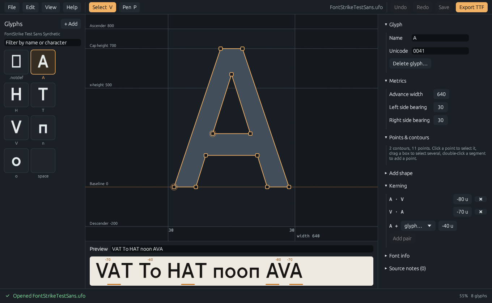
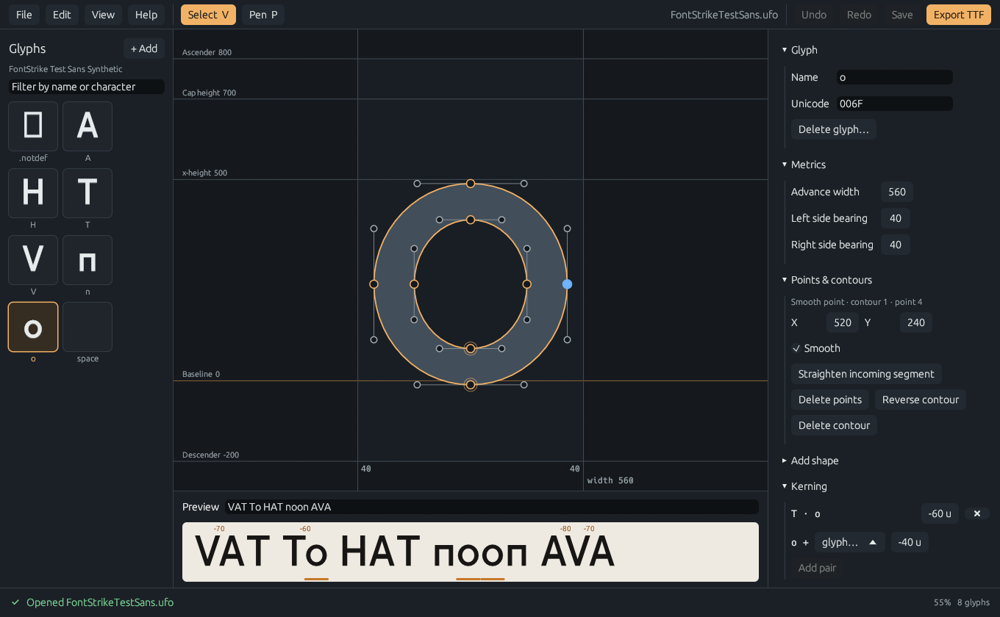
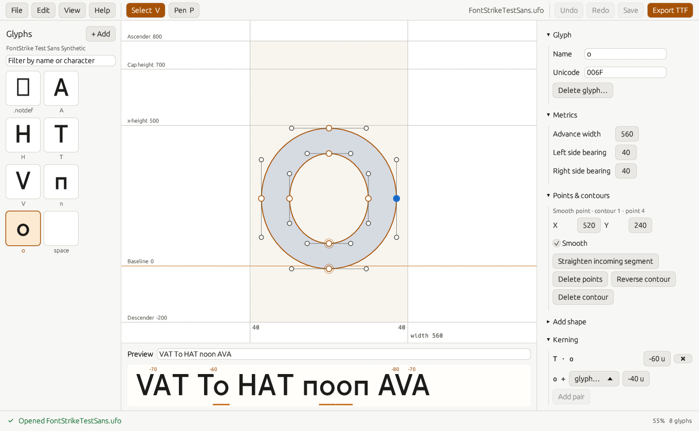
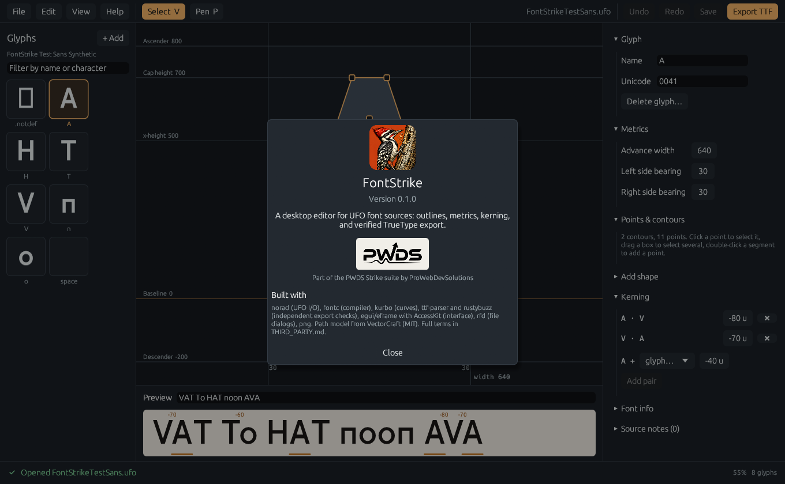
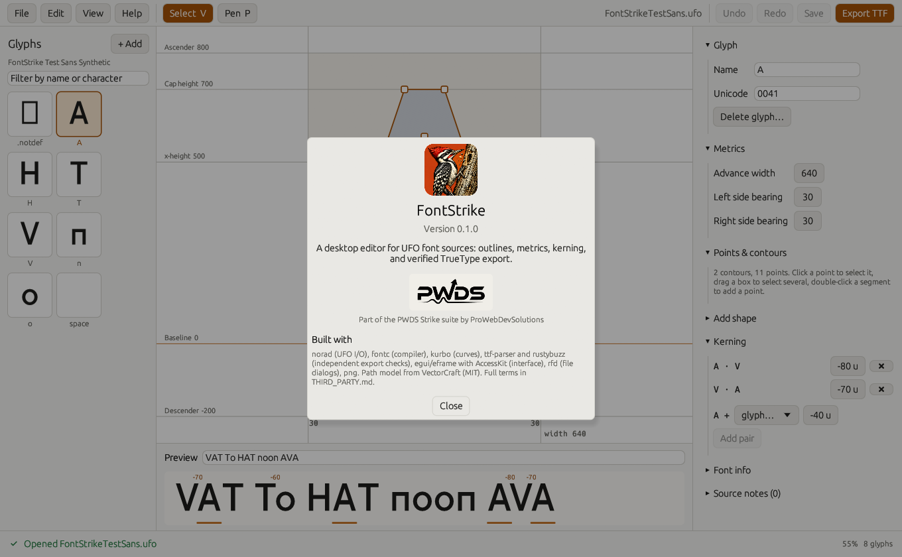
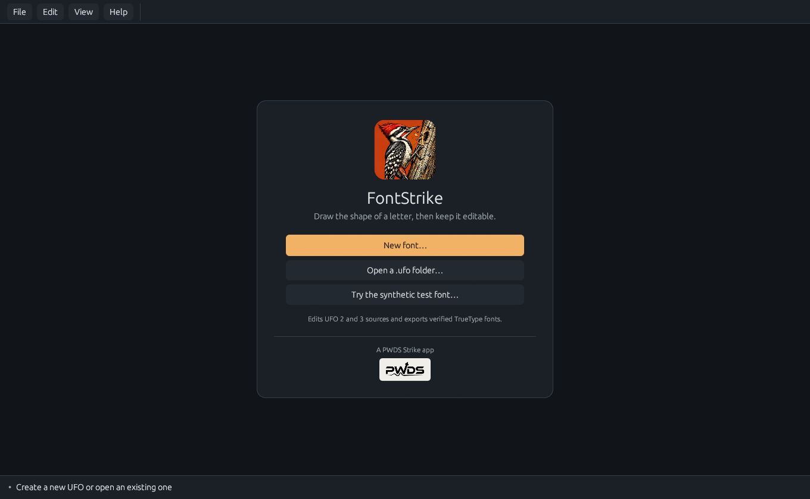
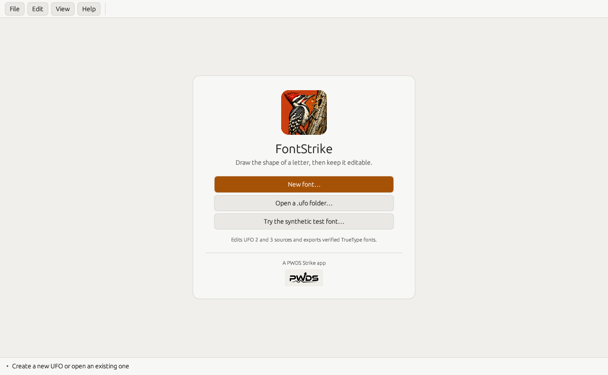
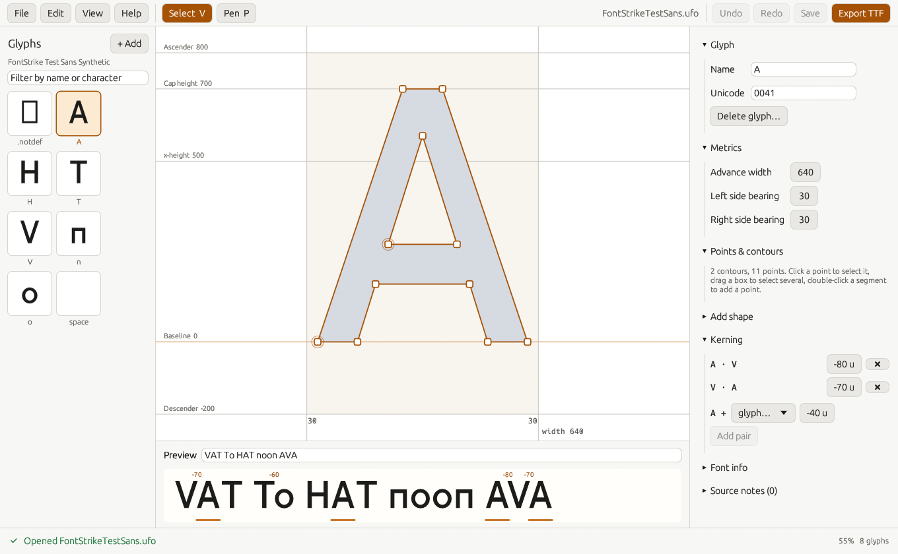
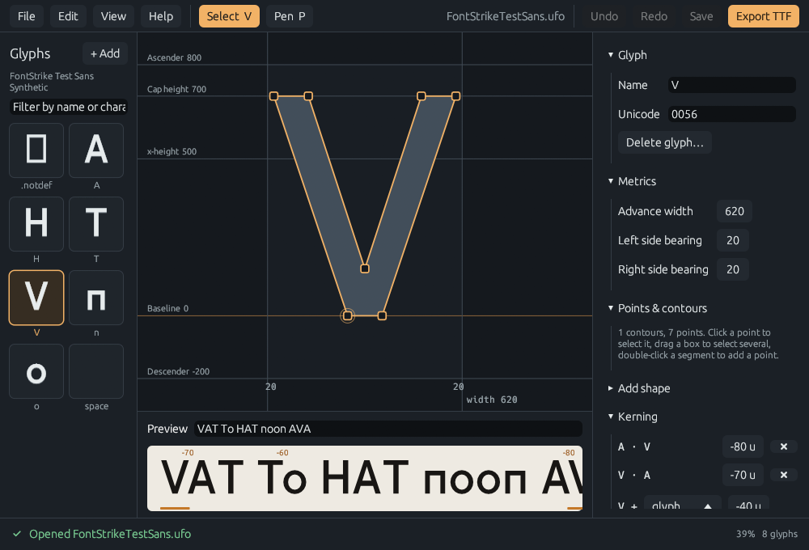

<p align="center">
  
</p>

<h1 align="center">FontStrike</h1>

<p align="center"><strong>Draw the shape of a letter, then keep it editable.</strong></p>

<p align="center">
  A desktop editor for UFO font sources: glyph outlines, metrics, kerning,<br>
  lossless saves with undo/redo and crash recovery, and verified TrueType export.
</p>

<p align="center">
  <a href="#what-works">What works</a> ·
  <a href="#supported-sources">Supported sources</a> ·
  <a href="#get-started">Get started</a> ·
  <a href="#platforms">Platforms</a> ·
  <a href="#status-and-limits">Status and limits</a> ·
  <a href="docs/VALIDATION.md">Export validation</a> ·
  <a href="docs/DEVELOPMENT.md">Development</a> ·
  <a href="#credits-and-licences">Credits</a>
</p>



*The running app editing **FontStrike Test Sans (Synthetic)**, a test font drawn from
coordinates in [`src/demo.rs`](src/demo.rs), in the default dark theme. Captured from the real window with the app's
`--capture` flag; see [Screenshots](#screenshots).*

## What works

### Draw and edit outlines
- **Point-level editing on the UFO data itself.** Drag points (Shift constrains to an axis,
  Esc cancels the drag), marquee and Shift selection, arrow-key nudges (Shift = 10 units),
  numeric X/Y fields. On-curve points carry their handles.
- **Change the shape:** double-click a segment to add a point, Delete to remove points
  (curves merge, keeping the outer handles), double-click a point to toggle smooth,
  convert segments between line and curve, reverse or delete contours.
- **Pen tool** (P): click to place points, click the first point (or press Esc) to close.
  **Add shape:** rectangles and ellipses by coordinates.
- Corner, smooth, off-curve, and contour-start points are drawn differently; a filled
  preview (non-zero winding, like the exported font) sits behind the outline; components
  are drawn in blue.

### Metrics, spacing, and kerning
- Advance width and left/right side bearings (side bearings shift the whole outline,
  components, and anchors).
- Glyph add, rename (kerning, groups, components, glyph order, and other layers follow),
  delete (with its kerning and group memberships), and Unicode values.
- Glyph-pair kerning, plus group kerning by `public.kern1.*` / `public.kern2.*` name, with
  UFO precedence rules (glyph exceptions beat group pairs).
- A **kerned text preview** rendered from the source; click a glyph in it to edit it.
- Font info: family, style, units per em, ascender, cap height, x-height, descender.

### Undo, save, recover
- **Undo/redo for every edit type**, labelled in the Edit menu ("Undo Move points").
  A drag or a dragged number field is one step.
- **Lossless saves.** Data FontStrike does not edit is written back: unknown `lib.plist`
  keys, extra layers, `features.fea`, groups, the `data/` folder, unknown files at the UFO
  root or in layer folders (copied byte-for-byte), and unknown `fontinfo.plist` /
  `layerinfo.plist` keys. Before a save replaces anything, the staged UFO is reloaded and
  compared with the in-memory model, and every original file must be reproduced or be
  data the model owns; otherwise the save stops and the source is untouched.
- **Crash-safe saves**: stage, journal, swap. An interrupted save is detected on open and
  **Recover** finishes it or keeps the last good version; unfinished copies are kept beside
  the UFO, never silently deleted.
- **Autosave** of unsaved edits every 30 seconds beside the UFO (never inside it); after a
  crash, FontStrike offers to restore or discard them.
- Changes made to the UFO by another program after opening are detected; FontStrike refuses
  to overwrite them.

### Export
- **Export TTF** (Ctrl+E; Cmd+E on macOS) compiles the current edits with [fontc](https://github.com/googlefonts/fontc)
  on a background thread, without modifying the UFO. The bytes are read back with
  ttf-parser (tables, unitsPerEm, family name, every Unicode mapping and advance, outline
  bounds) and kerning pairs are shaped with rustybuzz, before the file atomically replaces
  any previous export. A failed export leaves the previous file intact.
- Exports were also checked with two independent parsers (fontkit and opentype.js) and a
  hand-written checksum check: [docs/VALIDATION.md](docs/VALIDATION.md).

### Interface
- Menu bar, Select/Pen tools, Undo/Redo, Save, and Export in one compact toolbar; the file
  name shows its unsaved state. PWDS branding appears only on the start card and in About.
- Unsaved-change prompts on New, Open, and Quit (Ctrl+Q, or Cmd+Q on macOS, asks too).
  Keyboard shortcuts (Help → Keyboard shortcuts) use Ctrl on Windows and Linux and Cmd on
  macOS. Resizable panels that narrow on small windows (minimum 900 × 600).
- **Dark (default), Light, or System theme** under View → Theme. The choice applies at once
  and is remembered in the per-OS settings file (see [Platforms](#platforms)). Dark is the
  original look; Light keeps the orange accent, darkened so text, buttons, focus rings, and
  status colours meet WCAG AA (checked by unit tests), with its own canvas, outline, point,
  and preview colours. System follows the OS theme (on Linux, GNOME's `color-scheme` or
  `GTK_THEME` when the window system does not report it) and falls back to Dark if unknown.
- AccessKit is enabled, so controls are exposed to screen readers; form fields are
  labelled and the glyph grid, canvas, and preview describe themselves.

## Supported sources

| Input | Support |
| --- | --- |
| UFO 3 folder (`.ufo`) | Open, edit, save. |
| UFO 2 folder | Open and edit; **saved as UFO 3** (a note says so when you open it). |
| UFO 1 | Read through norad's upconversion; not tested with real files. |
| Newer UFO format (4+) | Refused, untouched. |
| `.ufoz`, `.glyphs`, `.designspace`, `.ttf`, `.otf` | Not supported. |
| Corrupt or unknown-element `.glif`, broken plists, missing glyph files | Refused with the reader's error; nothing is written. |
| UFOs containing symlinks | Refused. |

Within a supported UFO, FontStrike **edits** the default layer's contours, widths,
Unicode values, glyph names, kerning, and the font info fields above. It **keeps but does
not edit** other layers, components (drawn, not repositioned), anchors and guidelines,
images, glyph and font libs, features, and non-kerning groups. Quadratic (`qcurve`)
contours can have points moved and deleted, but multi-point quadratic runs cannot be
split. The **Source notes** panel lists what applies to the open font.

## Get started

Requires a Rust toolchain with edition 2024 support (tested locally with rustc 1.96.1) and,
on Linux, the system packages listed under [Platforms](#platforms).

```sh
cargo test --locked --features desktop
cargo run --locked --features desktop --bin fontstrike-desktop
```

Start with **Try the synthetic test font…** on the start card, or from the command line:

```sh
cargo run --locked --bin fontstrike -- demo TestSans.ufo
cargo run --locked --bin fontstrike -- export TestSans.ufo TestSans.ttf
cargo run --locked --features desktop --bin fontstrike-desktop -- --project TestSans.ufo
```

The CLI also has `new`, `rect`, `width`, `kern`, `status`, and `recover`. See
[docs/DEVELOPMENT.md](docs/DEVELOPMENT.md) for the architecture, test map, and capture flags.

## Platforms

A platform counts as supported only if CI builds **and** tests it. Status as of 2026-10-19,
from [CI run 39197467448](https://github.com/Gerbzz/FontStrike/actions/runs/39197467448)
(commit 696e830, stable rustc 1.99.1):

| Platform (CI runner) | Status | fmt, clippy `-D warnings` | `cargo test --locked --features desktop` | Release desktop binary | `--capture` of the running app |
| --- | --- | --- | --- | --- | --- |
| Windows x86-64 (`windows-latest`) | **Supported** (CI-built and tested) | pass | 61 passed, 0 failed (14 suites) | built | **not possible on the hosted runner**: it has no OpenGL 2.0 (`egui_glow requires opengl 2.0+`) |
| Linux x86-64 (`ubuntu-latest`, X11 via Xvfb) | **Supported** (CI-built and tested) | pass | 61 passed, 0 failed (14 suites) | built | dark and light frames captured under `xvfb-run` with Mesa llvmpipe |
| macOS arm64 (`macos-latest`) | **Supported** (CI-built and tested) | pass | 61 passed, 0 failed (14 suites) | built | dark and light frames captured |

No platform has been **hands-on tested** by a person in this round. The Windows build was
also built, tested, and captured from the command line on a Windows 11 PC (no interactive
use). On Linux and macOS, the menus, file dialogs (XDG portal on Linux), Cmd+Q, and theme
following have only been compiled and unit-tested, not clicked through. Wayland, Intel
macOS, and ARM Linux are not in CI. The exported test fonts also pass fontTools, a `ttx`
round trip, and OpenType Sanitizer on the Linux runner
([docs/VALIDATION.md](docs/VALIDATION.md)). Each run uploads the binaries, captures, and
exported fonts as artifacts (`fontstrike-desktop-<OS>`, `captures-<OS>`, `test-fonts-<OS>`).

### Prerequisites

- **All platforms:** a Rust toolchain with edition 2024 support (stable from rustup).
- **Windows:** the MSVC build tools (Visual Studio Build Tools, "Desktop development with
  C++").
- **macOS:** the Xcode Command Line Tools (`xcode-select --install`).
- **Linux (Debian/Ubuntu package names):** the eframe (winit, glutin, X11/Wayland) and rfd
  dependencies, plus an OpenGL driver:

  ```sh
  sudo apt-get install libxkbcommon-dev libxkbcommon-x11-0 libxcb-render0-dev \n    libxcb-shape0-dev libxcb-xfixes0-dev libwayland-dev libgl1 libegl1 libgl1-mesa-dri
  ```

  File dialogs go through the XDG desktop portal (`xdg-desktop-portal` plus a backend such
  as `-gtk` or `-gnome`), which desktop installs normally include. For headless capture,
  add `xvfb` and run the app under `xvfb-run`.

### Where settings live

| OS | File |
| --- | --- |
| Windows | `%APPDATA%\FontStrike\settings.ini` (same as earlier builds; read in place) |
| macOS | `~/Library/Application Support/FontStrike/settings.ini` |
| Linux/BSD | `$XDG_CONFIG_HOME/FontStrike/settings.ini`, else `~/.config/FontStrike/settings.ini` |

If an earlier build kept settings somewhere else (on macOS, `~/.config/FontStrike`), they
are copied over on first start; the old file is left in place.

### Platform notes

- Shortcuts use Cmd on macOS and Ctrl elsewhere. Cmd/Ctrl+Q quits, asking first if there
  are unsaved edits.
- On macOS, winit's default app menu is turned off, because its Quit would exit without
  that question. The menus are the ones inside the window, so there is no native app menu
  (Hide, Services).
- Saves swap folders by rename on every OS. On Linux and macOS the folders are also fsynced
  so a finished save survives power loss. UFOs that are symlinks, or that contain them, are
  refused.

## Status and limits

FontStrike is an **engineering preview**: the workflow above is implemented and tested,
but there is no installer and it has not been used on a large production font.

| Area | Implemented | Planned / not yet |
| --- | --- | --- |
| Outlines | Point move/insert/delete, smooth, line↔curve, reverse, pen, shapes | Handle-drawing pen drags, boolean operations, component placement editing |
| Spacing | Width, side bearings, glyph and group kerning | Kerning group editing, kerning class view, metrics keys |
| Sources | UFO 2/3, lossless round trip, recovery, autosave | Designspace / multiple masters, `.ufoz` |
| Export | Static TTF via fontc with independent checks | OTF/CFF, WOFF2, variable fonts, hinting |
| Validation | ttf-parser, rustybuzz, fontkit, opentype.js, fontTools + ttx, OTS | Validation on real-world fonts (fontTools, ttx, OTS run on the test fonts in CI) |
| UI | Responsive panels, shortcuts, AccessKit, Dark/Light/System themes | Narrator walkthrough, Windows high-contrast mode, localisation |

Known limits:
- Only the default layer is edited.
- Undo stores only the parts each edit touched, but the glyph grid, autosave, and export
  copy the whole font; fonts with thousands of glyphs have not been profiled.
- Export compiles in the background; saving runs on the UI thread.
- Pointer interaction with the built window was **not** exercised by an automated agent for
  this release (desktop control was declined). Editing behaviour is covered by the library
  tests, and the screenshots are real rendered frames, not interaction recordings. Theme
  switching through View → Theme was likewise not clicked through; the light captures use
  the `--theme light` flag, and persistence and resolution are covered by tests.

## Screenshots

All images are frames rendered by the running app (`fontstrike-desktop --capture FILE.png`
saves the window's own framebuffer) using the synthetic test font. No mockups. Dark is the
default theme; light captures use `--theme light`.

| Dark (default) | Light |
| --- | --- |
|  |  |
| *Dark: editing the o, smooth point selected, kerned preview.* | *Light: the same view.* |
|  |  |
| *Dark: About FontStrike and credits.* | *Light: About.* |
|  |  |
| *Dark: start card (with About, the only place PWDS branding appears).* | *Light: start card.* |
|  |  |
| *Light: the A, as in the top screenshot.* | *Dark: a 1000 × 680 window; panels shrink, nothing overlaps.* |

## Credits and licences

- **Libraries:** [norad](https://github.com/linebender/norad), [kurbo](https://github.com/linebender/kurbo),
  [fontc](https://github.com/googlefonts/fontc), [ttf-parser](https://github.com/harfbuzz/ttf-parser),
  [rustybuzz](https://github.com/harfbuzz/rustybuzz), [plist](https://github.com/ebarnard/rust-plist),
  [egui/eframe](https://github.com/emilk/egui) with [AccessKit](https://github.com/AccessKit/accesskit),
  [rfd](https://github.com/PolyMeilex/rfd), [png](https://github.com/image-rs/image-png), and
  [sha2](https://github.com/RustCrypto/hashes).
- **VectorCraft** path model (MIT), copied unchanged in `third_party/vectorcraft/`.
- README structure was informed by [PhotoCraft](https://github.com/storytold/photocraft) and
  [ArtCraft](https://getartcraft.com/); no text, code, or artwork was copied from them.
- Full terms: [THIRD_PARTY.md](THIRD_PARTY.md). No first-party licence grant is stated for
  FontStrike itself in this repository.

FontStrike is part of the PWDS Strike suite by
[ProWebDevSolutions](https://prowebdevsolutions.com). See the other
[Strike repositories](https://github.com/Gerbzz?tab=repositories&q=Strike).
